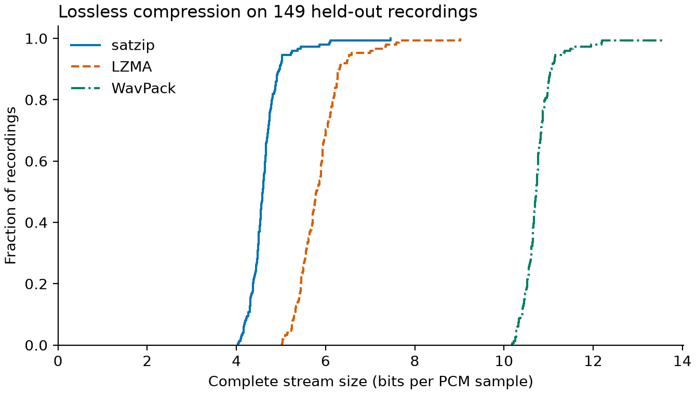
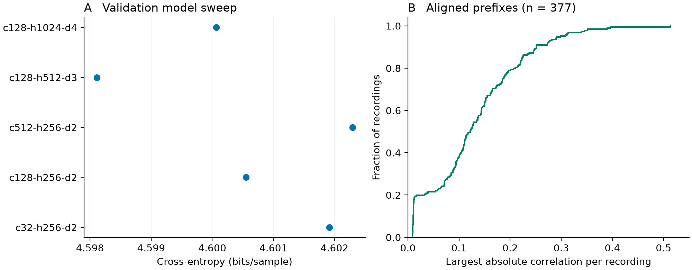

# Lossless compression of Neuralink electrode recordings

A single pretrained decoder compressed **149 held-out WAV files from 29,437,490 to 8,529,117 bytes (3.451×)**. The benchmark decoded each stream and checked the complete WAV byte for byte. Each file uses the same 10,795,953-byte checkpoint. The per-file score counts every stream byte and assumes the decoder already has that checkpoint.

A follow-up report compares these streams with the Sac lossless audio coder on the same files and derives information-theoretic bounds for the recordings: [How far can the recordings be compressed?](../neuralink_limits/README.md)

## Held-out stream measurements

| Method | Total stream bytes | WAV bytes / stream bytes | Stream bits / PCM sample |
|---|---:|---:|---:|
| satzip, shared prior | 8,529,117 | 3.451× | 4.637 |
| LZMA, preset 9 extreme | 10,775,716 | 2.732× | 5.858 |
| WavPack, -hh -x6 | 19,799,596 | 1.487× | 10.764 |



Each step represents one recording. At any rate on the horizontal axis, the curve gives the fraction of recordings encoded at or below that rate. The table uses ratios of totals. All 149 inputs are mono PCM16 with 44 bytes of WAV overhead. The baseline columns record sizes. The byte equality check in the runner applies to satzip. [Per-recording sizes and encode times](c128-h512-d3-bench.csv)

The split uses the zero-based index in the sorted WAV filenames. Every fifth recording went to the test set (149). Indices congruent to 1 modulo 20 went to validation (38). The other 556 went to training. The predictor sees earlier samples and running first-difference statistics, then a range coder encodes the observed ADC rank. The original runs built the 1,023-value rank table across all 743 WAVs. Rebuilding it from the 556 training WAVs produced the identical table. This split measures transfer to other files in the same corpus. Performance on a new session, device or subject remains unmeasured.

An earlier 16-file pilot with the small prior produced 911,436 bytes from 3,160,452 bytes (3.468×, all decoded exactly). These files are the first 16 of the 149. [Pilot measurements](small-bench.csv)

## Model capacity and signal statistics



**A.** Each point gives the validation cross-entropy across every sample in the 38 validation WAVs after 5,000 optimizer steps (batch 8,192). Model names give context length, hidden width and residual depth. The 2.70-million-parameter model reached 4.5981 bits/sample. Increasing capacity to 10.64 million parameters gave 4.6001. These are single runs per configuration. The observed plateau does not establish an entropy limit. [Checkpoint measurements](validation.csv) · [Recovered training log entries](training-log.csv)

**B.** Recording lengths ranged from 98,567 to 99,903 samples. We took the first 98,721 samples (the median length) of the 377 recordings long enough, standardized each recording's first differences, and measured zero-lag Pearson correlation against every other included recording. The strongest absolute correlation per recording had median 0.122, 90th percentile 0.251 and maximum 0.514. Regressing each series on the across-recording mean, including itself, explained a median 0.293% of variance (maximum 0.622%). Alignment is by sample index. Acquisition timestamps and joint coding gains were not measured. [Per-recording correlations](correlation.csv)

A separate linear prediction experiment drew 60 files at random (NumPy seed 0), fitted least-squares predictors on 40 and evaluated 20. Empirical rank entropy was 6.44 bits/sample, first-difference entropy 4.58, and rounded residual entropy 4.55, 4.53 and 4.53 at orders 4, 16 and 32. On the main validation split an order-32 fit using every fourth training file gave **4.7678**. These estimates omit stream overhead. In the 20-file probe, the mean periodogram of 65,536-sample rank prefixes placed 86.5%, 10.8%, 1.7% and 1.0% of power in the 0–300, 300–3,000, 3,000–6,000 and 6,000–9,765 Hz bands, respectively.

## Adaptation and memorization controls

On the first 12 validation files, a simulation scored each 4,096-sample block before updating the small prior. Fixed weights cost 4.7785 ideal bits/sample. Updating all weights with one Adam step at 0.0001 gave 4.7719, two at 0.0003 gave 4.7726, and four at 0.0001 with four blocks of replay gave 4.7701. Two output-head steps at 0.001 gave 4.7821.

On the first six validation recordings, a separate experiment trained on the first 80% of each recording and scored the final 20%. Mean ideal bits/sample were 4.639 for the general prior, 4.694 for a width-64 specialist, 7.523 for a width-256 specialist and 4.685 for the fine-tuned general prior. Fitting the entire recording gave 0.016 ideal bits/sample on that same data, or 436.820 including 16 bits per parameter. The general prior scored 4.623 on those whole recordings.

| Single validation recording | WAV or stream bytes | Decoder checkpoint bytes | WAV / stream |
|---|---:|---:|---:|
| Original WAV | 197,486 | — | 1.00× |
| Shared general prior | 56,057 | 10,795,953 shared | 3.52× |
| Prior fitted to this recording | 133 | 5,403,783 specific to this file | 1,484.86× |

Both streams restored the same WAV. The 133-byte stream plus its dedicated weights totals 5,403,916 bytes (27.36× the WAV). LZMA preset 9 reduces those weights alone to 4,813,636 bytes. The original and saved decoded file have the same SHA-256. An ensemble and bounded-error coding were proposed for future experiments. No measured gains from either are included here. [Artifact sizes and SHA-256 digests](single-recording.csv)

## Reproduction

Extract the challenge WAVs under `data/neuralink/data/`. The source ZIP has SHA-256 `a2288c85158f05eaf29b4d475c1128e061256511e65322090608ec90c2c2432a`. The full benchmark also needs the WavPack CLI on PATH. The measurements used PyTorch 2.15.0 with ROCm for the model sweep and CPU inference for coding. Use matching CPU and PyTorch environments for encoding and decoding. The published checkpoint contains the shared vocabulary and predictor weights. [Archived challenge data](https://web.archive.org/web/20240524221029id_/https://content.neuralink.com/compression-challenge/data.zip)

To encode a new recording and check the decoded file with the published prior, run this from the repository root.

```python
from pathlib import Path
import torch
from satzip import audio

prior = torch.load("reports/neuralink/c128-h512-d3.pt", weights_only=False)
wav = Path("recording.wav").read_bytes()
stream = audio.compress(wav, prior)
Path("recording.nz").write_bytes(stream)
assert audio.decompress(stream, prior) == wav
```

From the repository root, the following commands render both figures from the published CSVs, repeat the full stream comparison, repeat the correlation analysis and reproduce the one-file training control, respectively.

```sh
uv run python scripts/plot_neuralink.py
uv run python scripts/neuralink.py bench reports/neuralink/c128-h512-d3.pt
uv run python scripts/neuralink_correlation.py
uv run python scripts/neuralink_memorize.py --device cpu
```

To retrain the selected configuration on ROCm, run the training command in the ROCm environment. Training on another backend can produce different weights.

```sh
.venv-rocm/bin/python scripts/neuralink.py train /tmp/retrained.pt --context 128 --hidden 512 --depth 3 --steps 5000 --batch 8192 --device cuda
```
