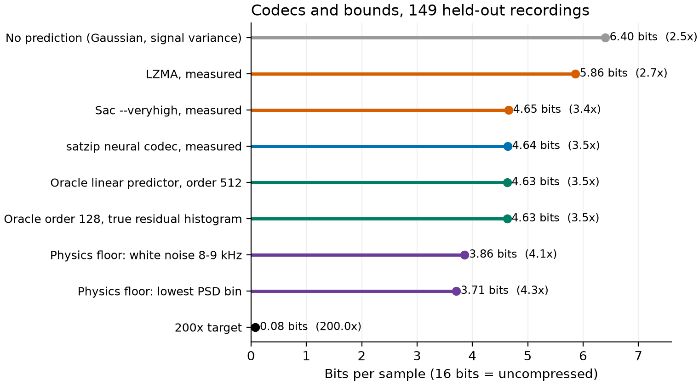
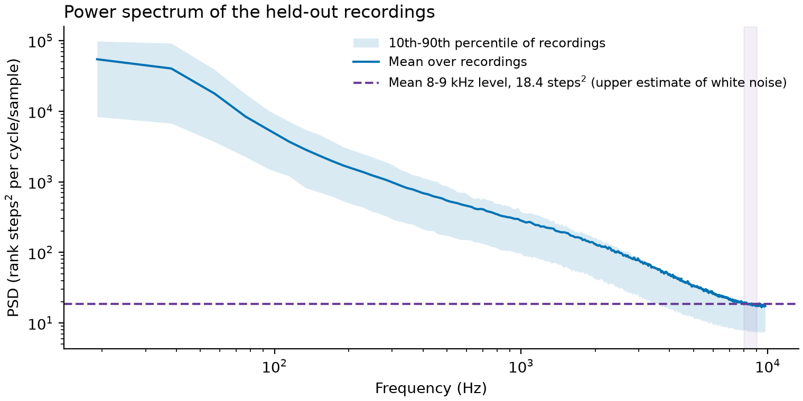

# How far can the Neuralink recordings be compressed losslessly?

On the 149 held-out recordings, the satzip codec spends **4.637 bits per sample (3.45×)**. A linear predictor fitted to each recording's own spectrum, which no real decoder could know in advance, needs **4.628**. Tests on the prediction residual found at most about 0.002 bits/sample of nonlinear structure, plus 0.005 bits of non-Gaussian error shape. Lossless coding of these recordings therefore appears to be within about 0.3% of what the data support. A ratio of 200× would require 0.08 bits/sample. That would mean finding more than 4.5 bits/sample of structure that none of these tests detected.



| | Bits per sample | Ratio (16 / bits) |
|---|---:|---:|
| No prediction (Gaussian with each recording's variance) | 6.400 | 2.50× |
| LZMA preset 9 extreme, measured streams | 5.858 | 2.73× |
| Sac v0.7.27 `--veryhigh`, measured streams | 4.654 | 3.44× |
| **satzip neural codec, measured streams** | **4.637** | **3.45×** |
| satzip ideal code length (model cross-entropy, no stream overhead) | 4.632 | 3.45× |
| Oracle linear predictor, order 512 (Gaussian bound for each recording's spectrum) | 4.628 | 3.46× |
| Oracle order 128 coded with its true residual histogram | 4.626 | 3.46× |
| Noise floor if all 8–9 kHz power is white noise | 3.861 | 4.14× |
| Noise floor from the lowest spectral bin above 300 Hz | 3.707 | 4.32× |
| 200× target | 0.080 | 200× |

Ratios ignore the 44-byte WAV header, which changes them by less than 0.1%. Measured rows come from complete, decoded streams. [satzip and LZMA streams](../neuralink/c128-h512-d3-bench.csv) · [Sac streams](../neuralink/sac-bench.csv) · [Per-recording bounds](per-recording.csv)

## Units

The recordings use 1,023 distinct 16-bit values, almost all 64 codes apart (spacing 63 to 128). Each sample is replaced by its rank in that value table, so one rank step is one ADC step, and every quantity below is in rank units. A continuous signal quantized with step 1 has discrete entropy close to its differential entropy whenever its spread is much larger than one step. Here the prediction error has a standard deviation of about 6 steps, so the approximation holds. The Gaussian code length used throughout is ½·log₂(2πe·σ²) bits.

## The argument

**1. No lossless code beats the entropy rate.** By Shannon's source coding theorem, the average length of any lossless code is at least the entropy rate H of the source. Arithmetic coding with the true conditional distributions reaches H to within a vanishing overhead. Every bit of improvement must therefore come from better probabilities.

**2. H cannot be computed from data alone.** Finding the shortest description of a dataset is uncomputable (Kolmogorov complexity). A dataset can therefore never prove that no better model exists. The bounds below rest on stated modeling assumptions. Every working codec does establish one hard fact: H is at most the rate that codec achieves.

**3. The Gaussian bound.** Among stationary processes with a given power spectrum S, the Gaussian process has the largest entropy rate. For a Gaussian process, the best predictor is linear. Its one-step error variance is given by the Kolmogorov–Szegő formula, σ²∞ = exp ∫ log S(f) df. We fitted linear predictors to each recording's own autocorrelation (Levinson–Durbin, orders 1 to 512). The Gaussian code length converges from 4.681 bits at order 1 to 4.632 at order 32 and 4.628 at order 512. This oracle sees the whole recording before coding it, which no causal decoder can do. The neural codec's ideal code length of 4.632 bits is 0.004 bits above the oracle. Its measured streams are 0.009 bits above.

**4. Room below the Gaussian bound requires nonlinear or non-Gaussian structure.** The tests below look for it in the order-128 oracle residual. They compare each recording with a phase-randomized surrogate. A surrogate has exactly the same power spectrum and no nonlinear structure.

| Test on the linear prediction residual | Real recordings | Surrogates | Real − surrogate |
|---|---:|---:|---:|
| Coding the true residual histogram instead of a Gaussian, bits saved | 0.005 | — | — |
| Variance from the previous 32 residuals, bits saved | −0.0234 | −0.0253 | +0.0019 |
| Variance from the previous 512 residuals, bits saved | −0.0006 | −0.0014 | +0.0008 |
| Variance from the previous 2,048 residuals, bits saved | +0.0005 | −0.0004 | +0.0009 |
| Correlation of \|e_t\| with \|e_t−1\| | 0.0320 | 0.0003 | |
| Correlation of \|e_t\| with \|e_t−10\| | 0.0050 | 0.0003 | |

The magnitude correlation is real: it is a hundred times larger than in the surrogates. It indicates bursts such as spikes. Converted into code length by a locally adaptive variance, it saves at most about 0.002 bits/sample on average. The largest saving in any one recording was 0.037 bits. Negative savings at short windows come from estimating a variance from few samples. The surrogates pay the same cost, so the comparison controls for it. The satzip network is itself a nonlinear predictor. It has 2.7 million parameters, sees 128 past samples and windowed noise statistics, and outputs a full distribution. It was trained on 556 other recordings. It did not get below the oracle. Model sweeps up to 10.6 million parameters and contexts of 512 samples changed validation cross-entropy by less than 0.005 bits ([model sweep](../neuralink/README.md#model-capacity-and-signal-statistics)).

**5. A physical floor, if the high-frequency power is noise.** Suppose the recording is a signal plus independent white noise N of variance σ²_N. Then even a decoder that knows the signal exactly needs H ≥ h(N) = ½·log₂(2πe·σ²_N) bits. To see why, note that H(X_t | past) ≥ H(X_t | past, signal) = h(N_t). The spectrum below falls steadily from 10⁴–10⁵ steps² below 100 Hz to about 18 steps² at 8–9 kHz, then flattens slightly before the anti-alias roll-off. White noise adds equally at every frequency, so its level cannot exceed the lowest part of the spectrum. Taking all of the 8–9 kHz power as white noise gives σ_N ≈ 3.7 steps and a floor of 3.86 bits (4.14×). Taking the lowest bin gives 3.71 bits (4.32×). These floors are upper estimates of the noise. If the electronics are quieter, the floor is lower. In that case the remaining high-frequency power belongs to the neural signal, and step 4 found it no more predictable than its spectrum allows. The gap between 4.63 and 3.86 bits is the background activity of many distant neurons in the 300–6,000 Hz band. A single-channel model can predict it only through its spectrum.



**6. The entropy coder is not a bottleneck.** The satzip streams use a range coder (arithmetic coding). Asymmetric numeral systems (ANS) reach the same −log₂ p length and differ mainly in speed. On these 149 files, the measured streams total 4.63682 bits/sample, against the model's ideal cross-entropy of 4.63185. Headers account for 0.00462 of the 0.00497 difference (57 bytes per file). The range coder itself costs about 0.0004 bits/sample (0.008%).

## Comparison with published results

Sac is an open-source lossless audio coder that leads its published benchmarks. It cascades adaptive OLS, NLMS and bias-correction stages per frame and tunes its parameters for each file. On the same 149 recordings it produced 8,561,092 bytes (3.438×) with `--veryhigh` and 8,565,240 (3.437×) with `--high`. satzip produced 8,529,117 (3.451×). Sac's stream was smaller on 17 of the 149 recordings. Choosing the smaller stream per recording saves 0.02% (8,527,143 bytes). Every Sac stream was decoded and compared byte for byte. An encode.su forum post reported Sac compressing all 743 challenge files to 42,227,445 bytes (about 3.48×). That set includes the training files, so it is not directly comparable.

The challenge asked for more than 200× lossless compression. Recent work on implant telemetry puts the lossless limit for broadband neural recordings below 10× because of thermal noise ([arXiv 2609.05786](https://arxiv.org/abs/2609.05786)). It argues for on-device lossy compression instead. Community submissions near 200× or above either discard the noise or were never shown to decode.

## Limitations

These bounds are for single-channel coding of these recordings. Joint coding of simultaneous channels could exploit shared signal. The best-partner correlation of first differences had median 0.122 ([correlation analysis](../neuralink/README.md#model-capacity-and-signal-statistics)). If that correlation were Gaussian and linear, it would be worth about 0.01 bits/sample. The noise floors assume the 8–9 kHz plateau is white and independent of the signal. The oracle bounds use each recording's in-sample autocorrelation. For order 512 on about 98,700 samples, overfitting lowers them by roughly p/n ≈ 0.5% in variance, or about 0.004 bits. The nonlinear tests cover marginal shape and variance clustering. They cannot exclude structure that no tested model, including the neural network, can represent.

## Reproduction

From the repository root, with the challenge WAVs under `data/neuralink/data/`:

```sh
.venv-rocm/bin/python scripts/neuralink_limits.py measure   # about 20 s on 24 threads; writes the CSVs
.venv-rocm/bin/python scripts/neuralink_limits.py plot      # renders both figures from the CSVs
git clone https://github.com/slmdev/sac && make -C sac -j LDFLAGS=-s
.venv-rocm/bin/python scripts/neuralink_sac.py sac/sac      # about 10 min; writes reports/neuralink/sac-bench.csv
```

The ideal code length in step 6 comes from `audio.bits_per_sample(wavs, prior)` with the published prior `reports/neuralink/c128-h512-d3.pt` on the same 149 recordings.
