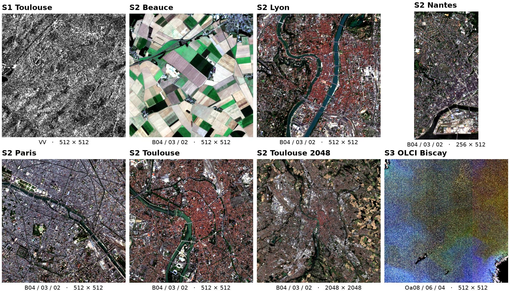
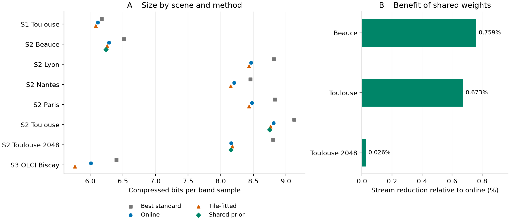

# Lossless compression of Sentinel satellite imagery

Across eight Sentinel windows, the same online satzip configuration reduced **47,185,920 raw bytes to 23,431,616 stream bytes** (2.014×, 50.34% smaller). On the three held-out Sentinel-2 windows, the pretrained decoder reduced **37,748,736 raw bytes to 19,072,071 stream bytes** (1.979×, 49.48% smaller). Both scores count complete image streams and exclude decoder weights. They cover different sets of windows.



**Figure 1.** These previews come from the integer arrays used in the benchmark. Sentinel-1 shows VV radar intensity, Sentinel-2 uses visible bands B04, B03 and B02 as RGB, and the Sentinel-3 OLCI composite uses reflectance bands Oa08, Oa06 and Oa04. Each displayed band is stretched between its valid 2nd and 98th percentiles. Pixels with missing OLCI values are displayed in black. The codec processes every original band at full resolution, including VH on Sentinel-1 and near-infrared B08 on Sentinel-2. The Nantes window is 256 pixels wide. [Copernicus Sentinel data via Microsoft Planetary Computer](https://planetarycomputer.microsoft.com/catalog)

## What gets counted

Raw bytes are the in-memory size of the uint16 band stack, calculated as width × height × bands × 2. A sample is one band value at one pixel. Stream bytes include the codec headers, lookup tables, masks and coded values. The ratio is total raw bytes divided by total stream bytes. All totals below count each window once, including both sizes of Toulouse.

| Same eight windows | Raw bytes | Compressed bytes | Raw / compressed | Bits per sample |
|---|---:|---:|---:|---:|
| Best standard codec per tile | 47,185,920 | 25,043,599 | 1.884× | 8.492 |
| satzip online, one Radeon configuration | 47,185,920 | 23,431,616 | 2.014× | 7.945 |
| satzip CPU, fitted separately to each tile, weights excluded | 47,185,920 | 23,396,869 | 2.017× | 7.934 |

The tile-fitted row counts the exact length of the inner satzip stream in each saved two-pass archive. Decoding each of those streams requires its own fitted weights. The online row starts from the same initialization on every tile. For a model trained once and reused on new scenes, the held-out comparison below is the relevant measurement.



**Figure 2.** Each point in A is a measured size for one scene and method. The original arrays use 16 bits per sample. Open water, farmland, radar and city scenes produced different rates. Panel B compares the shared prior to online initialization at the same settings on each held-out window. [Exact stream sizes for the figure](stream-sizes.csv)

## Standalone archives and baseline codecs

Measured on the eight NPZ files downloaded by `scripts/download_data.py --no-lst`. CPU SZ1, SZ2, tuned CPU configurations, the Radeon residual network and the standard codecs used the same integer arrays. Every measured codec was decoded and checked. The 512 × 512 Toulouse Sentinel-2 tile is also the central window of the 2048 × 2048 tile. The per-file results count both inputs independently.

| Tile | Raw bytes | Best CPU bytes¹ | Radeon online bytes | Best standard bytes² | Smallest independent result | Saving vs raw |
|---|---:|---:|---:|---:|---|---:|
| S1 Toulouse | 1,048,576 | 400,938 | 400,812 | 404,559 | GPU online | 61.78% |
| S2 Beauce | 2,097,152 | 826,079 | 824,238 | 854,135 | GPU online | 60.70% |
| S2 Lyon | 2,097,152 | 1,113,323 | 1,109,752 | 1,155,316 | GPU online | 47.08% |
| S2 Nantes | 1,048,576 | 538,296 | 537,777 | 553,972 | GPU online | 48.71% |
| S2 Paris | 2,097,152 | 1,113,473 | 1,111,530 | 1,157,683 | GPU online | 47.00% |
| S2 Toulouse | 2,097,152 | 1,155,811 | 1,154,689 | 1,196,271 | GPU online | 44.94% |
| S2 Toulouse 2048 | 33,554,432 | 17,172,431 | 17,111,632 | 18,463,470 | GPU online | 49.00% |
| S3 OLCI Biscay | 3,145,728 | 1,148,904 | 1,181,186 | 1,258,193 | CPU two-pass (steps=1, weights included) | 63.48% |

¹ Includes a two-pass CPU experiment with four pretraining epochs per tile. Its archive size includes its float16 weights, stream and NPZ overhead. Other CPU candidates use the original SZ1 network, default SZ2, or the settings listed in the CSV.

² Standard codecs use the repository’s per-band payload accounting. Image codec sizes include eight bytes per band for the integer offset. JPEG XL effort 9 also tried planar and grouped layouts, with reversible rank mapping where applicable. Multi-band wrappers and external raster metadata are excluded from standard-codec totals.

## All eight files, encoded independently

| Method | Compressed bytes | Ratio | Saving vs raw |
|---|---:|---:|---:|
| shuffle+zlib-9 | 29,761,967 | 1.59× | 36.93% |
| shuffle+zstd-19 | 29,417,071 | 1.60× | 37.66% |
| lzma-9e | 30,490,580 | 1.55× | 35.38% |
| CCSDS-121 (libaec) | 30,492,708 | 1.55× | 35.38% |
| PNG | 35,177,031 | 1.34× | 25.45% |
| JPEG 2000 | 27,812,998 | 1.70× | 41.06% |
| JPEG XL effort 7, independent bands | 26,094,835 | 1.81× | 44.70% |
| Best standard per tile | 25,043,599 | 1.88× | 46.93% |
| CPU SZ1 | 24,627,194 | 1.92× | 47.81% |
| CPU SZ2 | 23,566,252 | 2.00× | 50.06% |
| Best CPU per tile | 23,469,255 | 2.01× | 50.26% |
| Radeon online | 23,431,616 | 2.01× | 50.34% |
| Best independent codec per tile | 23,399,334 | 2.02× | 50.41% |

The raw integer arrays occupy 47,185,920 bytes. The downloaded NPZ files occupy 47,189,928 bytes.

## Shared Sentinel-2 model

The shared model was trained on Paris, Lyon and Nantes. Its serialized weights occupy 3,916,050 bytes. Only held-out Sentinel-2 tiles used it in this comparison.

| Held-out window | Raw bytes | Online bytes | Shared-model stream bytes | Raw / shared stream | Reduction vs raw |
|---|---:|---:|---:|---:|---:|
| S2 Beauce | 2,097,152 | 824,238 | 817,978 | 2.564× | 61.00% |
| S2 Toulouse | 2,097,152 | 1,154,689 | 1,146,921 | 1.829× | 45.31% |
| S2 Toulouse 2048 | 33,554,432 | 17,111,632 | 17,107,172 | 1.961× | 49.02% |
| **Total** | **37,748,736** | **19,090,559** | **19,072,071** | **1.979×** | **49.48%** |

Decoding all three saved streams with the published checkpoint reproduced the source arrays exactly, including shape and dtype. Pretraining saved 18,488 bytes (0.097% of the online streams) across the three windows. The largest tile contributes 88.9% of the raw bytes. The three windows cover two held-out locations, and the Toulouse windows overlap. A stronger next test would freeze this prior and evaluate non-overlapping scenes from additional locations and seasons, reporting the paired saving per scene. [Shared float16 decoder weights](sentinel2-prior.npz)

## Additional training experiments

A separate sweep varied online update counts, network size and tile-specific pretraining on four 512 × 512 windows. For example, the 16-epoch CPU fit on Biscay produced a 1,124,981-byte stream from 3,145,728 raw bytes (2.796×). Its 14,340 bytes of float16 weights are excluded from that stream score. The JSON records include configuration, timing and byte accounting for each run. [CPU sweep](../09_more_training/results-cpu.json) · [Radeon sweep](../09_more_training/results-cuda.json) · [Large-model comparison](../07_big_models/results-cuda.json)

## Compressed collection

The bundle occupies **22,248,690 bytes** including its manifest and file headers. It stores the smallest tested standalone satzip archive for each distinct tile and reconstructs the verified central Toulouse window from the larger tile. Each manifest entry includes the SHA-256 of the original NPZ file. The bundle uses the project-local PyTorch 2.15.0+rocm10.0 runtime on the Radeon RX 7800 XT for GPU streams.

From the repository root, restore the bundle to a new directory with:

```sh
.venv-rocm/bin/python scripts/restore_tiles.py data/compressed/sentinel-tiles.zip restored-tiles
```

Run the comparison again with:

```sh
for mode in cpu gpu standard two-pass bundle; do
    .venv-rocm/bin/python scripts/compare_tiles.py "$mode" || break
done
```

The complete per-codec and per-configuration measurements are in [measurements.csv](measurements.csv).


Explore the published measurements with `uv run marimo edit notebooks/08_benchmark.py`. Rebuild the rate plot directly from the published CSV with `uv run python scripts/plot_satellites.py --rates-only`. To reproduce the previews and stream-size CSV, fetch the tiles with `scripts/download_data.py --no-lst`, run the comparison above in the ROCm environment, then run `.venv-rocm/bin/python scripts/plot_satellites.py`.
